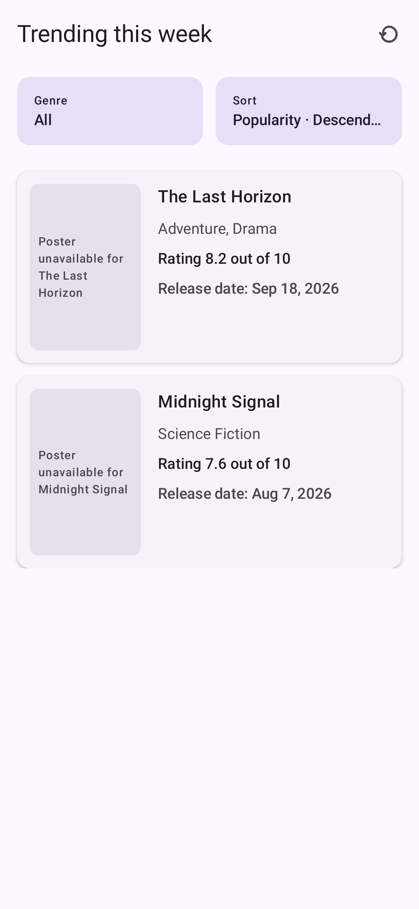
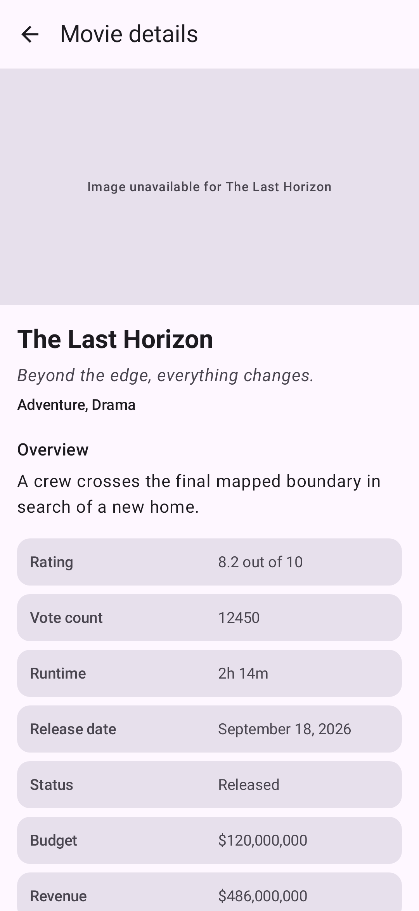

# AmroMovies

## Project overview

AmroMovies is the first version of AMRO's Android app. It shows this week's top 100 trending movies from TMDB, lets users filter that list by genre, sort it by popularity, title, or release date, and open a movie to see its full details.

The project is intentionally shaped like a real application rather than a disposable demo. It uses Compose, MVVM, unidirectional data flow, Koin, Retrofit, Room, and a modular structure that leaves room for future features without turning the MVP into a framework.

What is implemented:

- weekly top 100 trending movies;
- genre filtering within those same 100 movies;
- ascending and descending sorting by popularity, title, and release date;
- a movie-detail screen with all fields requested in the assignment;
- Room caching for trending movies;
- loading, refresh, empty, offline, and server-error states;
- unit, repository, network, Room, ViewModel, Compose, instrumentation, and screenshot tests.

Personalized recommendations are part of AMRO's longer-term product direction, but they are not part of this MVP's concrete screen requirements and are not implemented here.

## Screenshots

These are also the golden images used by the screenshot tests, so they stay in sync with the UI checked by the test suite.

| Trending | Movie details |
|---|---|
|  |  |

## Requirements

- Android Studio with support for Android Gradle Plugin 9.2.1 and Kotlin 2.2.10
- JDK 21 for Gradle
- Android SDK Platform 36
- A TMDB API Read Access Token

The app compiles against Android 36.1, targets API 36, and supports API 24 and newer. The repository includes the Gradle 9.4.1 wrapper, so a separate Gradle installation is not needed.

## Setup

1. Clone the repository:

   ```bash
   git clone <repository-url>
   cd AmroMovies
   ```

2. Open it in Android Studio and install the requested JDK and Android SDK if needed.

3. Configure a TMDB token as described below.

4. Sync Gradle and run the `app` configuration on an emulator or device running API 24 or newer.

## TMDB credential configuration

Create or update the root `local.properties` file:

```properties
access_token=YOUR_TMDB_API_READ_ACCESS_TOKEN
```

Use the TMDB API Read Access Token, not the shorter v3 API key. The client sends it as a Bearer token in the `Authorization` header.

An environment variable can be used instead:

```bash
export TMDB_ACCESS_TOKEN=YOUR_TMDB_API_READ_ACCESS_TOKEN
```

`TMDB_ACCESS_TOKEN` takes precedence over `local.properties`. Gradle exposes the value through `BuildConfig`, and the app's Koin setup passes it to the network client.

`local.properties` is ignored by Git and should never be committed. Like any credential packaged in a mobile client, the token can still be extracted from a built APK. A backend proxy would be needed if AMRO later requires server-grade credential protection.

## Build and run

Run these commands from the repository root. A token must be configured before Gradle evaluates the application module.

```bash
# Build the debug APK
./gradlew assembleDebug

# Run all local tests
./gradlew test

# Run only debug unit and Robolectric tests
./gradlew testDebugUnitTest

# Run Android lint
./gradlew lintDebug

# Build the minified, resource-shrunk release APK
./gradlew assembleRelease
```

The app can be launched from Android Studio after selecting the `app` run configuration.

## Architecture

The project follows Clean Architecture principles, but it does not add a class or module only to make the layer diagram longer.

```text
Compose Route / Screen
        ↓ actions
ViewModel + StateFlow
        ↓
MoviesRepository contract
        ↓
DefaultMoviesRepository
        ├── remote data source → Retrofit / TMDB
        └── local data source  → Room
        ↓
immutable UI state → Compose
```

The main rule is that dependencies point towards stable application contracts:

- Domain owns the application models, errors, results, and repository contract.
- Features depend on that contract, not on Retrofit or Room.
- Data implements the contract and owns pagination, caching, and error translation.
- Network and database modules provide the concrete infrastructure.
- The app module connects everything through Koin.

There is no standalone use-case layer at the moment. The current operations would only forward calls to `MoviesRepository`, which would add names without adding behavior. A use case becomes worthwhile when an operation coordinates several repositories or represents reusable application policy.

## Module structure

| Module | Responsibility | Depends on |
|---|---|---|
| `:app` | Application startup, navigation, credential wiring, and the Koin composition root | Core and feature modules |
| `:core:common` | The injectable clock used by cache freshness logic | Nothing |
| `:core:domain` | Pure Kotlin models, `AppResult`, `AppError`, and `MoviesRepository` | Nothing |
| `:core:data` | Repository implementation, data-source contracts, mapping, pagination, caching policy, and error translation | `:core:common`, `:core:domain` |
| `:core:network` | TMDB API, DTOs, Retrofit, OkHttp, serialization, authentication, and remote data source | `:core:data` |
| `:core:database` | Room database, DAO, entities, relationships, cache metadata, and local data source | `:core:data` |
| `:core:designsystem` | Shared Material 3 theme, colors, and typography | No project modules |
| `:feature:trending` | Trending state, actions, ViewModel, filtering, sorting, Compose UI, and Koin registration | `:core:domain`, `:core:designsystem` |
| `:feature:moviedetail` | Detail state, ViewModel, display formatting, Compose UI, and Koin registration | `:core:domain`, `:core:designsystem` |

This is enough separation for feature ownership without creating one Gradle module per class. If future teams need to share feature contracts with one another, small feature API modules can be introduced at that point.

## Dependency injection

Koin was selected because it is part of the target stack, has a small Kotlin DSL, and fits the size of the app. Hilt would also be a valid Android DI option, but introducing both would serve no purpose.

The app module registers the network, database, repository, trending, and movie-detail modules. Infrastructure and the repository use `single`, while ViewModels use Koin's `viewModel` registration.

Koin is only used to construct objects. Domain models, repository contracts, mapping, and business rules do not depend on Koin or Android `Context`.

## State management

Both features use MVVM with unidirectional data flow:

```text
user interaction
      ↓
typed action
      ↓
ViewModel
      ↓
immutable UiState
      ↓
Compose
```

Each ViewModel keeps its `MutableStateFlow` private and exposes a read-only `StateFlow`. Route composables obtain the ViewModel, collect state with `collectAsStateWithLifecycle()`, and pass state and callbacks into stateless screen composables.

Loading and refreshing are separate states. This allows cached content to remain visible during a manual refresh instead of replacing the list with a full-screen spinner.

## Network layer

The TMDB client uses:

- Retrofit;
- OkHttp;
- Kotlinx Serialization;
- Bearer-token authentication.

Implemented endpoints:

- `GET trending/movie/week`
- `GET genre/movie/list`
- `GET movie/{movie_id}`

The client uses a 10-second connection timeout and 30-second read, write, and total call timeouts. Debug builds install BASIC HTTP logging and redact the authorization header. Release builds do not install the logging interceptor.

TMDB DTOs stay inside `:core:network`. They are mapped into data-boundary models before leaving the module and never reach domain or Compose code.

## Top 100 trending logic

TMDB returns trending movies in pages. The repository hides that detail from the rest of the app:

1. Fetch the first page and read the available page count.
2. Fetch more pages in structured batches using `coroutineScope`, `async`, and `awaitAll`.
3. Merge responses in page order.
4. Ignore duplicate movie IDs after their first appearance.
5. Stop once 100 unique movies have been collected or TMDB has no more pages.
6. Store at most 100 movies with their trending rank.

The ViewModel never sees a TMDB page number.

Filtering and sorting run only against this canonical top-100 dataset. Changing a genre or sort option does not call the network, and the visible list scrolls back to the top after either selection changes.

## Caching and offline behavior

Room is the source of truth for the trending screen:

```text
TMDB refresh
     ↓
repository policy and mapping
     ↓
transactional Room replacement
     ↓
Room Flow
     ↓
ViewModel
```

The cache stores movies, genres, movie/genre relationships, trending rank, and the last successful refresh time. Replacing the trending dataset is transactional, so observers never see a partially updated list.

The automatic startup refresh is skipped when the cache is less than one hour old. Manual refresh and retry bypass that freshness check. An injectable `AppClock` makes the policy deterministic in tests, and a mutex prevents duplicate refreshes from running together.

If a refresh fails, existing cached movies remain visible and the UI can show an inline error. This provides useful offline behavior without introducing a background synchronization framework.

Movie details are not cached yet, so opening a detail screen still requires a successful network request. Coil handles image memory and disk caching; image files are not stored in Room.

## Error handling

Technical failures are interpreted before they reach presentation code:

```text
IOException / HTTP / serialization failure
                 ↓
remote data failure
                 ↓
AppError
                 ↓
feature-specific UI error
```

ViewModels do not depend on Retrofit, `HttpException`, `IOException`, or Room DAOs. They receive typed `AppResult` values and map application errors to messages appropriate for each screen.

`CancellationException` is always rethrown at exception-mapping boundaries. Loading is kept in UI state rather than being added to a generic result wrapper used across every layer.

## Compose stability and performance

- Domain models have no Compose annotations or dependencies.
- Presentation models use `@Immutable` only when their properties meet that contract.
- Persistent immutable collections are used in UI state where they are useful.
- There are no blanket `@Stable` annotations.
- Trending rows use `movie.id` as their stable `LazyColumn` key.
- Filtering, sorting, mapping, and formatting stay outside composables.
- Route composables own lifecycle collection and navigation; screens remain stateless.

The top-100 transformations are small enough to run synchronously. If the dataset or transformation cost grows later, the current boundaries allow dispatcher-backed computation to be introduced without changing the composable APIs.

## Navigation

Navigation Compose defines the trending destination and `movie/{movieId}` detail destination. Only the movie ID is passed through navigation; the full movie object is not serialized into the route.

`MovieDetailViewModel` receives that ID through Koin parameters and loads its own data. This also leaves the detail screen ready to be opened from future features or deep links.

## Testing strategy

Code coverage is not currently measured. The test suite instead focuses on the paths where regressions would affect application behavior.

### Unit and business-logic tests

- every genre, sort option, and direction combination;
- case-insensitive title ordering;
- deterministic handling of missing release dates;
- top-100 boundaries and source-list immutability;
- available genre calculation;
- domain, remote, cached, and presentation mapping;
- date, currency, runtime, IMDb, and missing-value formatting.

### ViewModel tests

- initial loading and cached-content success;
- application-error to UI-error mapping;
- retry and forced refresh;
- refreshing while content remains visible;
- genre and sort changes without network refresh;
- no-result filtering;
- movie-detail loading, success, failure, and retry.

### Repository, network, and Room tests

- page aggregation, ordering, deduplication, and the 100-item limit;
- fewer-than-100 responses;
- concurrent page loading and duplicate-refresh suppression;
- fresh-cache and forced-refresh behavior;
- offline, HTTP, serialization, and cancellation failures;
- TMDB paths, headers, authentication, and logging configuration;
- Room ranking, relationships, transactional replacement, and stale-row cleanup.

MockWebServer is used for HTTP tests. Room tests run with Robolectric and the Room testing library.

### Compose and instrumentation tests

Compose tests cover loading, errors, retry actions, empty states, movie content, missing images, genre selection, sorting controls, scroll-to-top behavior, detail fallbacks, navigation callbacks, and valid IMDb actions.

The feature instrumentation tests exercise loading-to-offline-error behavior on an Android device for both screens.

### Screenshot tests

Roborazzi compares representative loaded states for the trending and movie-detail screens with the PNG references shown above. The tests use a fixed viewport, API level, locale, light theme, and static image fallbacks to keep rendering deterministic.

Verify the current references:

```bash
./gradlew :feature:trending:verifyRoborazziDebug \
  :feature:moviedetail:verifyRoborazziDebug
```

After an intentional UI change has been reviewed, record new references:

```bash
./gradlew :feature:trending:recordRoborazziDebug \
  :feature:moviedetail:recordRoborazziDebug
```

Recording updates the files under each feature's `src/test/screenshots` directory. Review those image changes before committing them.

## Key decisions

- **Koin as dependency injection:**keeps DI construction concise.
- **Moderate modularization:** features and infrastructure have clear ownership without splitting every layer into tiny modules.
- **Separate domain and UI models:** domain remains platform-independent while presentation can contain display-ready values.
- **Repository-level error mapping:** technical exceptions do not leak into ViewModels.
- **Local filtering and sorting:** the list always represents transformations of the same top 100 and does not make surprise network calls.
- **Room as source of truth:** cached and freshly downloaded trending movies follow one consistent path into the UI.
- **No generic `Base*` classes:** shared abstractions exist only when they describe a real boundary.

## Trade-offs

- The cache covers trending movies, not every endpoint.
- Movie details remain network-only.
- Cache freshness is a simple fixed one-hour policy.
- Genres are refreshed with trending movies rather than maintained as a separate catalog.
- Feature UI and presentation logic share one feature module. Separate feature API modules can be added if cross-feature dependencies appear.
- Screenshot tests cover one representative loaded state per screen. Semantic tests cover loading, error, and interaction behavior.
- The UI prioritizes the assignment flows and accessibility over a large branded component system or advanced animation.

## Known limitations

- Movie details require a network request because detail data is not persisted.
- There is no scheduled or background refresh.
- TMDB requests currently use the fixed `en-US` language.
- Only one genre can be selected at a time.
- There is no search or user-personalization flow.
- There is no paging UI because TMDB pagination is consumed internally to build the fixed top 100.
- Test coverage is broad but no percentage is measured.
- The repository does not include production signing or store-distribution configuration.
- There are no performance benchmarks, analytics, crash reporting, or production observability integrations.

